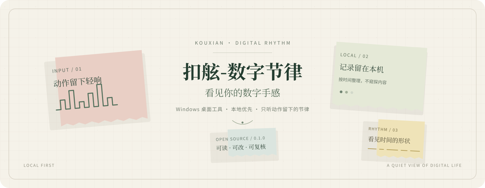

  

# 扣舷-数字节律

Windows 桌面工具 · 本地优先 · <a href="LICENSE">MIT</a> · 公开源码 v0.1.0 · 应用版本 v0.12.1

[使用指南](docs/user-guide.md) · [源码运行](docs/building-from-source.md) · [隐私说明](docs/data-and-privacy.md) · [报告缺陷](docs/bug-reporting.md) · [参与贡献](CONTRIBUTING.md)

看见电脑前的动作节律：输入事件、鼠标响应、前台应用停留与时间分布。它帮你回看数字生活，不给效率、健康或人格打分。

“扣舷”取意于“扣舷而歌”：不窥探内容，只听动作留下的轻响。

> 不读取输入内容，不记录鼠标坐标、屏幕截图或窗口标题。数据默认留在本机。只有在你主动配置并使用 AI 或邮件功能时，相关聚合数据才会发送到你选择的服务。具体范围见[数据与隐私说明](docs/data-and-privacy.md)。

## 看见什么

- 键盘、点击与滚轮事件的时间分布。
- 前台应用的进程名、可执行文件路径与停留区间。
- 健康采集覆盖、小时热力图、日历趋势和个人参照。
- 可选的 AI 回放与周报、月报；云端处理只在你配置服务并主动启用后发生。

## 从源码运行

应用运行环境为 Windows 10/11 与 Python 3.10 或更新版本；CI 使用 Python 3.11。桌面窗口需要 WebView2 Runtime。

    py -3.11 -m venv .venv
    .\.venv\Scripts\python.exe -m pip install -r requirements.txt -r requirements-dev.txt

运行测试与静态检查：

    .\.venv\Scripts\python.exe -m pytest tests -q
    .\.venv\Scripts\python.exe -m compileall -q config.py db.py diagnostics.py interaction_rhythm main.py mimo_client.py monitor.py settings.py startup_guard.py stats.py tray.py update_manager.py weekly_report.py window.py
    node scripts/check_inline_js.js

运行桌面应用前，请先阅读[数据与隐私说明](docs/data-and-privacy.md)。启动应用会开始本机事件采集。默认数据目录为工程根目录下的 data/；开发时可先把它指向临时目录：

    $env:INTERACTION_RHYTHM_DATA_DIR = Join-Path $env:TEMP 'digital-rhythm-dev-data'
    .\.venv\Scripts\python.exe main.py

更多环境说明见[源码构建指南](docs/building-from-source.md)。

## 版本与下载

v0.1.0 是首个公开源码标签，源码中的应用版本仍为 v0.12.1 / epoch 2。源码标签不代表新的 Windows 安装包已发布。

本次源码 Release 不提供 Windows 安装包。旧公开分发仓库中 `v0.11.3`、`v0.11.6`、`v0.11.8` 的安装器与便携包均已撤下；Release/tag 仅保留版本说明，不提供软件包。要使用当前源码，请按上文从源码构建。

公开源码仓库、私有开发工作区与历史分发记录的边界见[项目范围](docs/project-scope.md)。

## 面向 Agent 的协作

仓库根目录的 [AGENTS.md](AGENTS.md) 提供代码地图、测试命令和数据边界。欢迎人在 Agent 辅助下阅读、修改和贡献；提交前请检查数据、凭据和第三方素材来源。

## 报告问题

普通缺陷请使用[公开 Issue](https://github.com/Ansel-Poiesis/interaction-rhythm-source/issues)；安全漏洞请走 [GitHub 私密漏洞报告](https://github.com/Ansel-Poiesis/interaction-rhythm-source/security/advisories/new)。请勿在公开报告中附上本机数据库、日志、截图、导出文件、邮箱或密钥。

## 许可证

本仓库代码和原创说明文档使用 MIT。字体等第三方材料仍按各自许可证发布，详见 [THIRD_PARTY_NOTICES.md](THIRD_PARTY_NOTICES.md)。项目名称与标志不授予商标使用权。
